# LiakOS

LiakOS combines the UI minimalism of a tiling window manager with the flow of a floating window manager. It is built on **Wayfire**, with a set of custom applications that tie the desktop experience together.

The main bar is built with **AGS**, and the custom applications are written in **C with GTK 4**. Wallpaper-based colors bring the bar, apps, and desktop together.

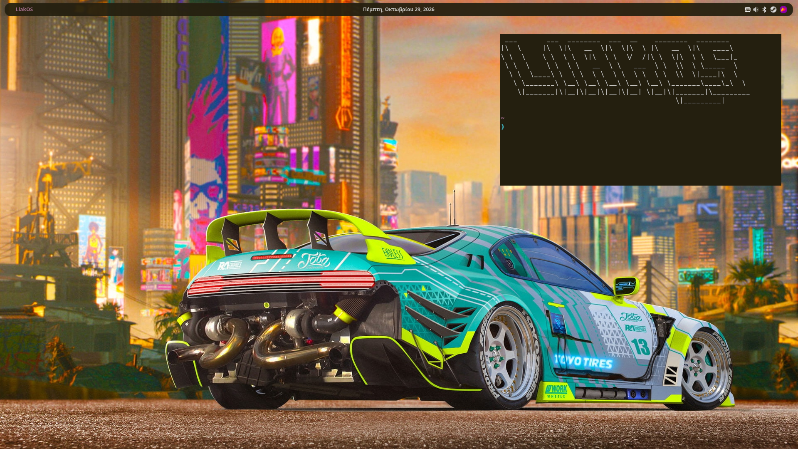

## Application bar

The bar keeps everyday controls within reach:

- **Left:** click the LiakOS name to open a quick menu for common settings and tools.
- **Center:** switch between full date, compact date, media controls, and live audio bars. Click the dates or audio bars to change modes; media mode has its own change button.
- **Right:** a system tray for applications such as Discord, Steam, and Spotify, alongside custom bus schedule, sound, and Bluetooth controls.

### Media controls

See what's playing and control it directly from the bar with **previous, play/pause, stop, and next**. Media mode follows a playing MPRIS player automatically; click the track to switch between available players. Use the change button beside the controls to move to the audio visualizer.

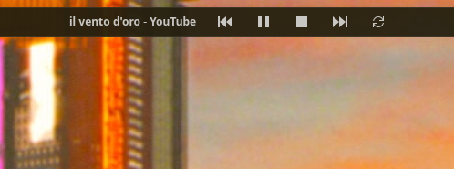

### Live audio visualizer

Turn the center of the bar into moving audio bars that follow your desktop's sound, including apps without media metadata. Bass sits at the outer edges, with higher frequencies toward the center, and the bars use the wallpaper's accent color. Click the visualizer to return to the full date.

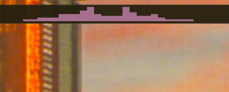

The visualizer requires `cava` and `pipewire-pulse`. Audio capture runs only while this mode is visible.

### Quick menu

The LiakOS menu gives you access to power profiles, display brightness, screen recording, screenshots, and the desktop's settings apps.

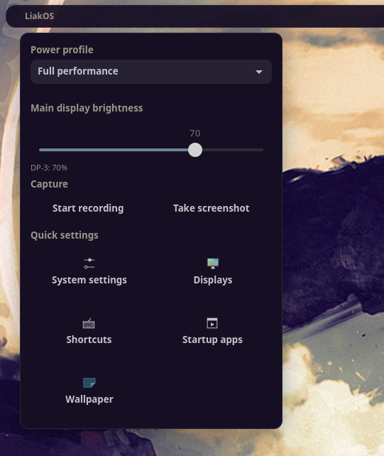

### Bus schedules

Check upcoming departures for your selected bus lines without leaving the desktop. Click the bus icon to view schedules, or right-click it to choose your lines.

The background fetcher currently supports **OASA transport in Athens, Greece**.

| Upcoming departures | Choose your bus lines |
| --- | --- |
| 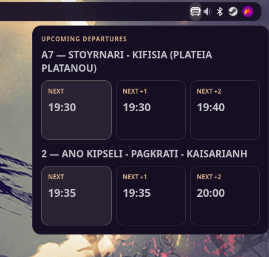 | 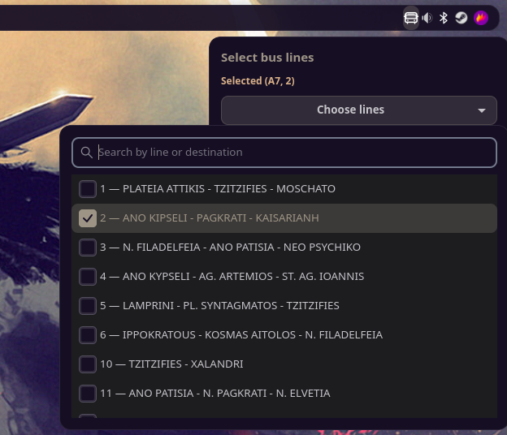 |

### Sound mixer

Control the master volume, audio devices, and the volume of individual running applications from the bar.

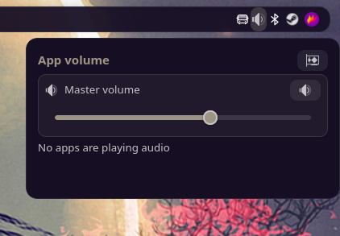

### Bluetooth

Turn Bluetooth on or off, scan for devices, and manage connections from one panel.

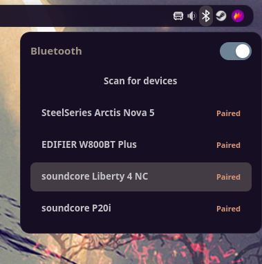

## Custom applications

### Lpaper — wallpapers and desktop colors

Choose a wallpaper and let **Pywal16** generate a matching color scheme. Lpaper applies those colors to GTK, Qt, the custom applications, and the bar, so the desktop follows your wallpaper.

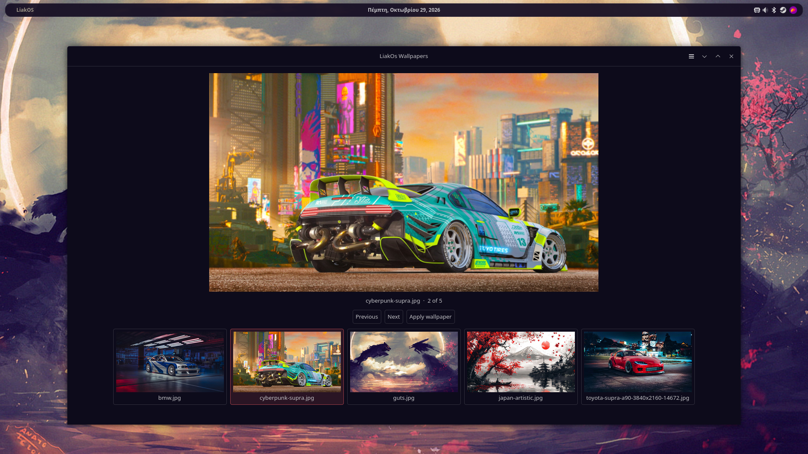

### Keybindings

Edit your current Wayfire shortcuts through a GUI instead of modifying `wayfire.ini` by hand. Search for an action, choose **Edit shortcut**, and record the new key combination.

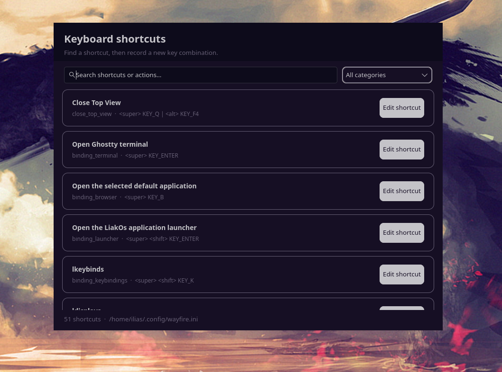

### MonitorApp

Configure your monitor setup from a simple interface. After the 15-second preview, **Keep settings** saves position, resolution/refresh, scale, rotation, and enabled state in `~/.config/kanshi/config`. Kanshi restores the saved layout when the session starts or monitors reconnect. See [display persistence and migration](monitor-app/README.md) for details and limitations.

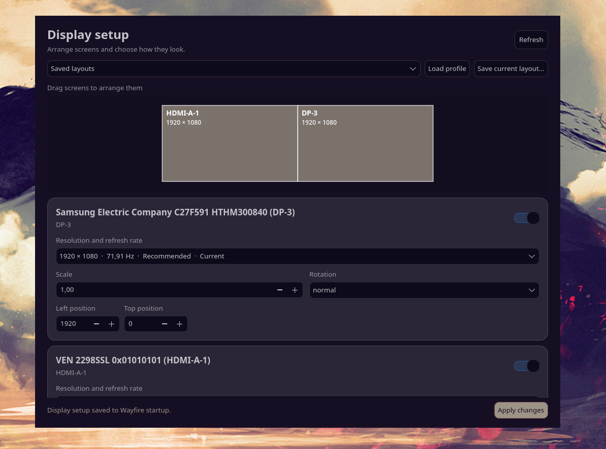

### Autostart

Choose which applications run when you log in, including programs such as Steam and Spotify.

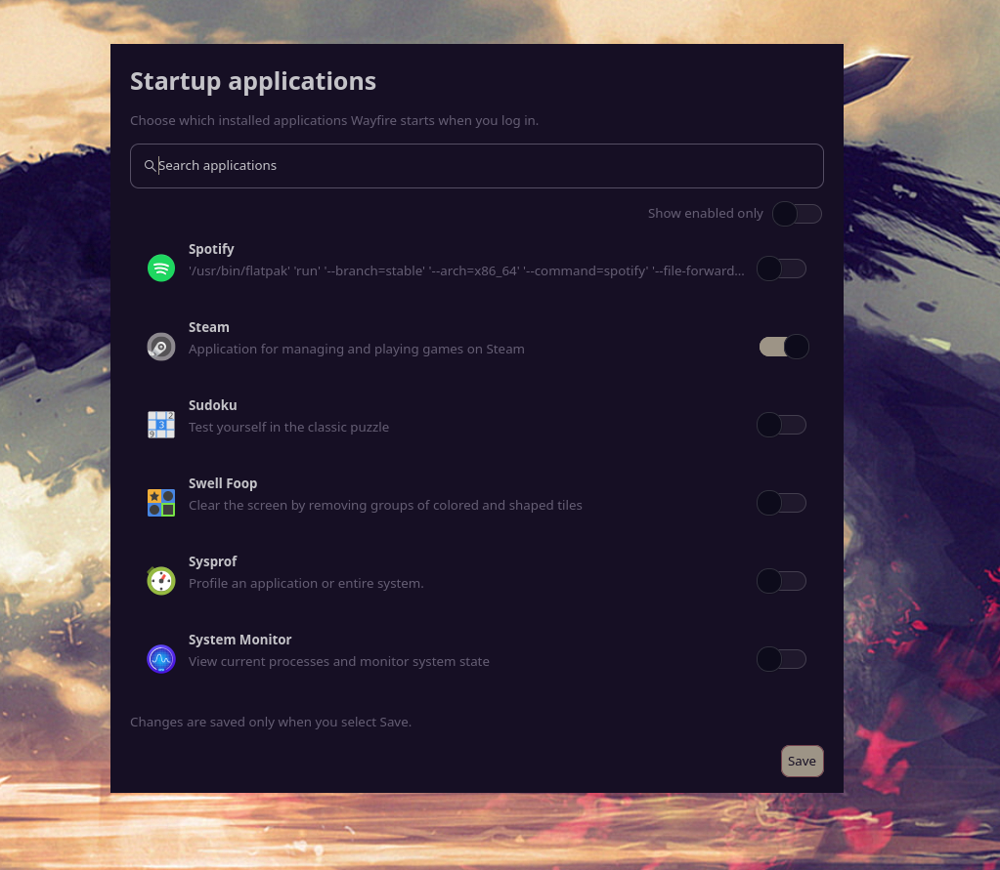

### SessionApp

A simple session menu for logging out, restarting, or powering off the system.

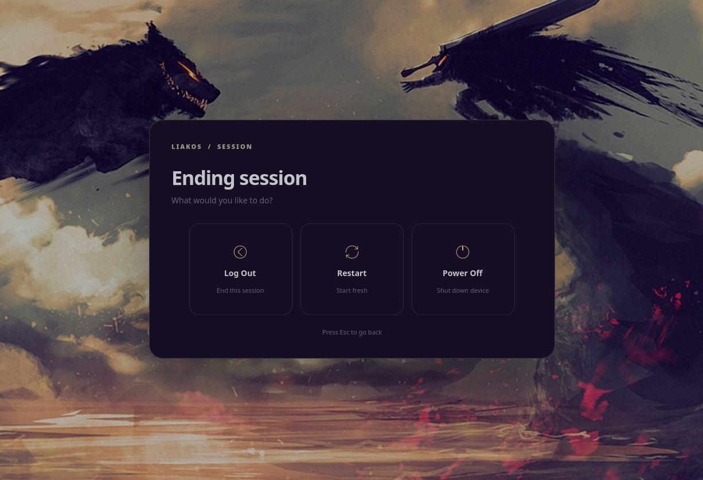

### Llauncher

A simple application launcher with search as you type. Launch an application or focus its existing Wayfire window.

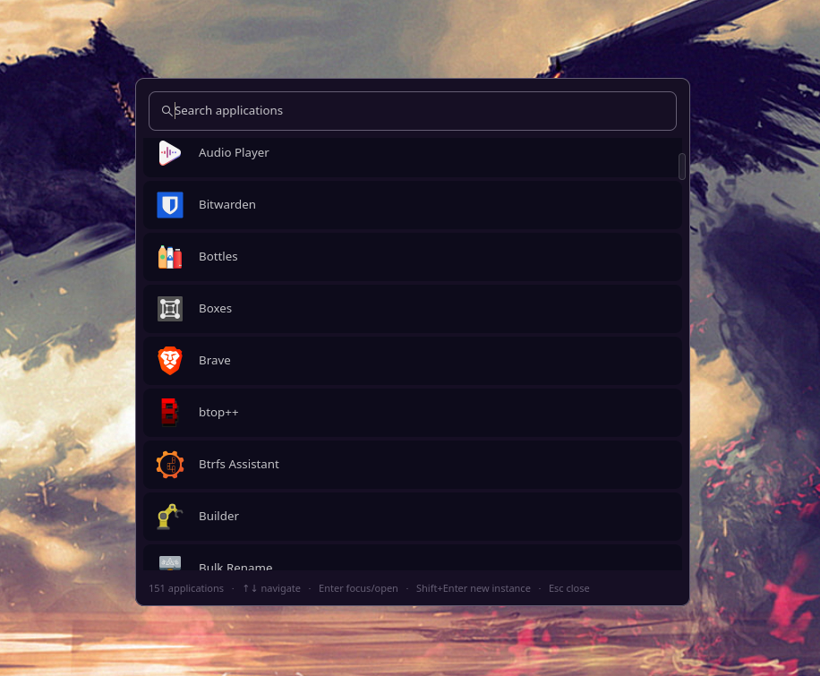

### Settings

A simple settings app, still growing, for displays, mouse and touchpad, sound, and system updates, with shortcuts to wallpaper and keybinding tools.

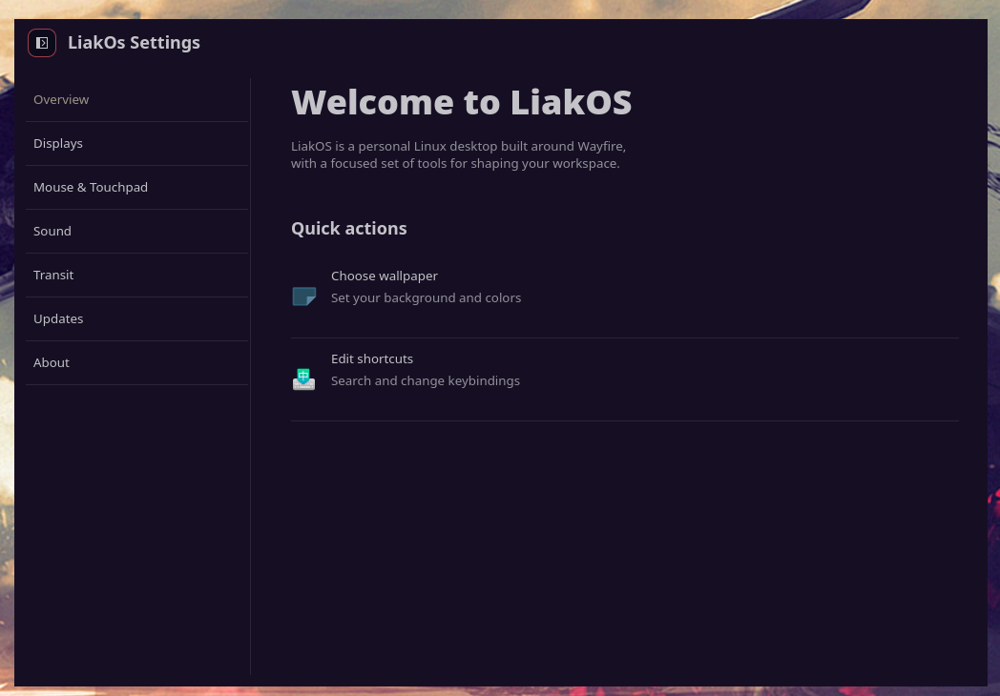
